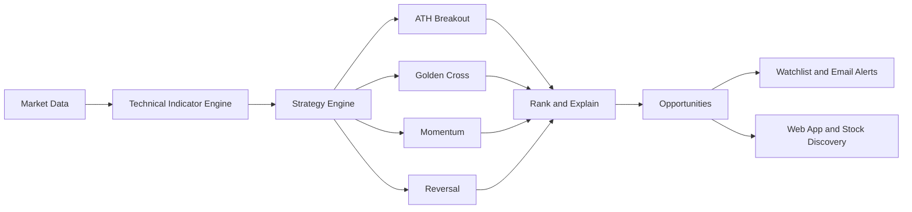

# EveryATH — Brand & Product Strategy

My recommendation is to keep EveryATH.com and "Every ATH. Every Opportunity." — but expand the product strategy, not the brand name.

Your advantage is that ATH (All-Time High) breakouts are a clear, memorable starting point. You can grow into a broader AI stock-discovery platform without abandoning the identity you've already built.

## 1. Keep the Brand, Expand What It Means

> **EveryATH**
> *Every ATH. Every Opportunity.*
> AI-powered stock discovery and timely alerts

| Feature | Description |
| --- | --- |
| ATH Breakouts | Your flagship feature |
| Golden Cross | Trend-change opportunities |
| Momentum & Reversals | RSI, MACD and trend changes |
| Smart Alerts | Email when conditions match |

The tagline doesn't need to describe every feature literally. It communicates your original mission: finding stock opportunities and helping users discover them.

## 2. Build a Strategy Engine, Not a Collection of Unrelated Indicators

This is the most important product decision.

Don't build separate systems for ATH, Golden Cross, RSI, and MACD. Build one reusable technical-analysis engine that supports many discovery strategies.

For example, calculate moving averages, RSI, MACD, and volume metrics once, then reuse them across multiple strategies. This also fits your earlier architecture, where technical indicators are stored in DynamoDB.

The strategic benefit: adding a new strategy becomes cheaper and faster over time.

## 3. Expand in Three Phases

### Phase 1 — Launch: Own the ATH Breakout Niche

- All-time-high breakouts
- Near-ATH watchlist
- Volume-confirmed breakouts
- Reliable email alerts
- Clear explanation of why each stock qualifies

**Goal:** establish trust and prove that users return for the discoveries.

### Phase 2 — Expand: Add Complementary Opportunities

- Golden Cross
- Momentum acceleration
- MACD bullish crossover
- RSI-based setups
- Trend continuation and reversal patterns

**Goal:** serve more investing styles and increase the reasons to subscribe.

### Phase 3 — Scale: Become an AI Stock-Discovery Platform

- Rank opportunities across strategies
- Explain why a stock is interesting in plain English
- Combine technical patterns with news and fundamentals
- Personalize alerts by watchlist and preferred strategies

**Goal:** move beyond a scanner to a daily stock-discovery workflow.

## 4. Differentiate on Opportunities, Not the Number of Indicators

Many platforms can calculate a Golden Cross or RSI. Merely offering more indicators is unlikely to be a durable advantage.

EveryATH should answer four questions for each stock:

1. **What happened?** The stock reached an ATH or formed a Golden Cross.
2. **Why does it matter?** Explain the pattern and supporting evidence.
3. **How strong is the setup?** Show volume confirmation, trend context, and relevant risk factors.
4. **What should I watch?** Identify relevant price levels or conditions that would invalidate the setup, without promising returns.

Your AI layer should make technical analysis easier to understand, rather than just adding an AI label to conventional indicators.

## 5. Organize the Product Around Discovery

I would use this navigation structure:

| Nav item | Description |
| --- | --- |
| Discover | Ranked opportunities from all strategies |
| Strategies | ATH, Golden Cross, Momentum, Reversals |
| Watchlist | Save stocks and track their setups |
| Alerts | Manage email notifications and conditions |

Notice that Discover is the primary experience, not Indicators. Most users want to find promising stocks, not learn the names of every technical formula.

## 6. What I Would Prioritize First

| Priority | Investment | Why |
| --- | --- | --- |
| 1 | Reliable ATH scanner | Establishes your initial identity |
| 2 | Watchlist and email alerts | Creates recurring product value |
| 3 | Golden Cross | Adds a complementary discovery strategy |
| 4 | Opportunity ranking and explanations | Creates a more differentiated experience |
| 5 | More indicators and patterns | Expand based on user demand |
| 6 | News and fundamentals | Adds context once the core works well |

Track alert engagement, returning users, subscriber conversion, and the historical performance of each strategy. Measure performance after realistic transaction costs and avoid presenting backtests as guarantees of future results.

## Final Strategy

- **Brand:** EveryATH
- **Tagline:** Every ATH. Every Opportunity.
- **Product category:** AI-powered stock discovery and alerts.
- **Initial wedge:** ATH breakouts.
- **Expansion strategy:** Golden Cross and other technical setups powered by a common strategy engine.
- **Long-term advantage:** Finding, ranking, explaining, and delivering useful stock opportunities better than a basic scanner.

One final point: you don't need to buy a broader domain such as TradeSeeker.com just because the product expands. Your existing brand can work as an umbrella for all these capabilities.
